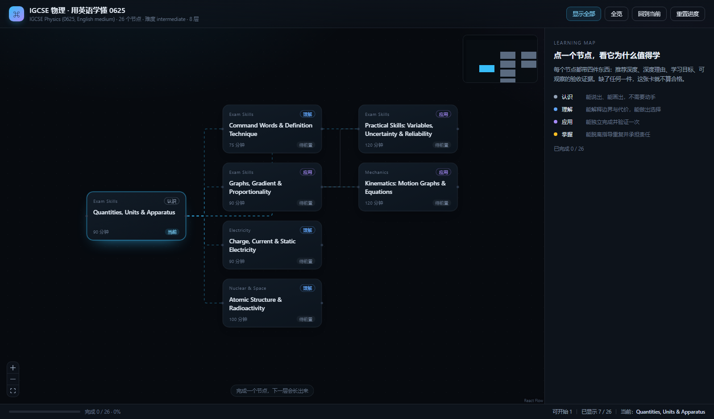
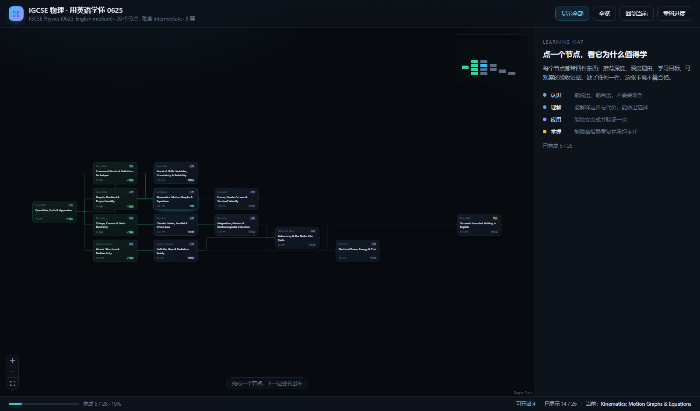
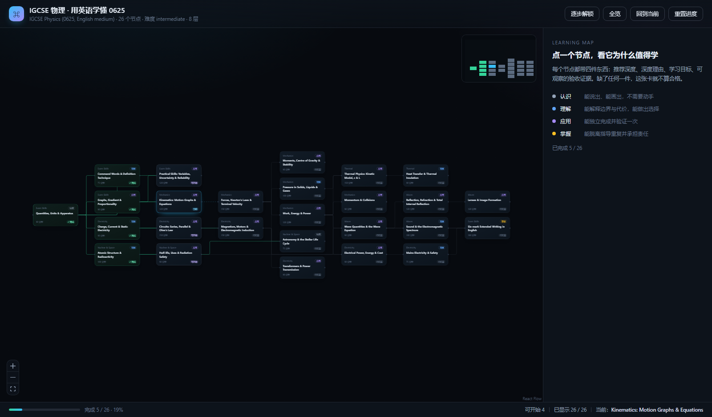
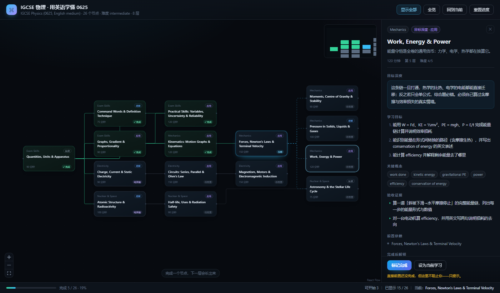
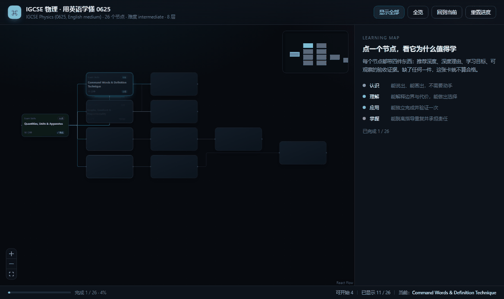

# Skill Tree Demo

一个不依赖 MapFlow 后端的最小学习技能树实现：`@xyflow/react` 画依赖图 + 分层自动布局 + **完成一个节点、下一层长出来**的逐步解锁 + 节点详情（目标深度 / 学习目标 / 验收证据）+ 进度与「当前学习」。数据契约与 MapFlow 的 `SKILL_TREE.json` 兼容，同一份 JSON 既能喂这里，也能喂它的 `mapflow.create_tree`。

## 跑起来

```bash
pnpm install     # 或 npm install
pnpm dev         # http://127.0.0.1:5183
```

产物构建：`pnpm build`（`tsc --noEmit` + `vite build`，输出 `dist/`，`base: './'` 可直接静态托管）。

> 仓库里的 `pnpm-workspace.yaml` 把 `nodeLinker` 固定成 `hoisted`：pnpm 默认的严格链接在这种 Windows + OneDrive 路径下会让 vite 解析不到 `esbuild`，hoisted 布局最省事。用 npm 则不需要关心。

## 交互

| 动作 | 结果 |
| --- | --- |
| 点节点 | 右侧展开详情；窄屏从底部弹出 |
| 标记完成 | 播一次绿色脉冲，进度 +1，**它连着的下一层节点依次浮现**，镜头平滑外扩；若它是「当前」，自动把当前挪到下一个可开始的节点 |
| 设为当前 | 蓝青色高亮 + 从它出发的边变为流动虚线 |
| 显示全部 / 逐步解锁 | 随时在全树与「只看到可达范围」之间切换 |
| 全览 / 回到当前 | 全览取景当前可见集合；回到当前只框住「当前节点 + 它的直接后继」 |
| 重置进度 | 清空进度回到初始状态（此时只显示起点和它的直接后继） |
| Esc / 点空白 | 关闭面板 |

进度与显示模式存在 `localStorage` 的 `skill-tree-demo:v1` 键里，刷新不丢。**没有后端，也没有账号**——这是 demo 的边界。

演示与截图用的 URL 参数：`?node=n9` 打开节点详情，`?done=n1,n2&current=n3&all=1` 预置进度和显示模式。






## 逐步解锁与动画

d


可见性规则（`src/reveal.ts`）：

```
visible = 已完成 ∪ 当前 ∪ 可开始
        ∪ 这些节点的直接后继
        ∪ 选中节点及其祖先（深链兜底）
```

- 只比「当前 + 可开始」多看一跳：你能看见下一步，但看不到更远，所以完成一个节点时**整条下一层**才会涌入。
- 未解锁节点**不渲染**（不是灰显）。隐藏不会引起重排 —— 坐标来自静态布局，节点只是重新挂载。
- 节点入场：`mf-node-in`（左移 14px + 缩放 0.96 + 淡入，420ms），延迟 = `(层-1)×70ms + 行×40ms`，形成从左往右依次亮起。
- 边：刚完成节点连出去的边在 900ms 内保持流动虚线，表示「通电解锁」。
- 完成脉冲：`mf-glow` 绿色 ring 外扩一次。
- 相机：完成 / 切换当前 / 切换显示模式后，等一帧再 `fitView` 到新的可见集合（480ms，`minZoom 0.4 / maxZoom 1.05`），既外扩又不会缩到看不清。
- `prefers-reduced-motion: reduce` 时动画与相机过渡全部关闭。

## 目录

```
src/
├── schema.ts                  # 数据契约 + 归一化（含线上转义字符串兼容）
├── layout.ts                  # 分层布局、拓扑排序、环检测、可开始判断
├── reveal.ts                  # 逐步解锁的可见集合、入场延迟
├── data/skillTree.json        # 示例：IGCSE 物理（0625，英语授课）26 节点 / 33 边
├── components/SkillNodeCard.tsx
├── components/DetailPanel.tsx
├── App.tsx                    # 状态、进度持久化、相机调度、React Flow 装配
└── styles.css
```

## 数据契约

顶层五个字段，和 MapFlow 的 `LearningTreeSnapshot` 一致：

```ts
{ tree, nodes, edges, current_node_id, progress }
```

节点的四个「有质量」字段是这个产品的核心，缺一件这张卡就不合格：

| 字段 | 作用 |
| --- | --- |
| `recommended_depth` | 目标深度：`Recognize` / `Understand` / `Use` / `Master`（认识/理解/应用/掌握） |
| `depth_rationale` | 为什么是这个深度，必须说清「为什么不能再低」 |
| `learning_objectives` | 以「能…」开头的可判断行为，禁止「了解」「掌握」这类不可验证词 |
| `observable_evidence` | 什么产物能证明做到了：跑了什么命令、看到什么输出 |

### 两个坑

1. **三个列表字段的类型是 `string`，不是 `string[]`。** MapFlow 线上契约里 `learning_objectives` / `key_concepts` / `observable_evidence` 存的是 `"[\"能…\",\"能…\"]"` 这种转义字符串。本项目的 `normalizeTree()` 两种形态都收，所以你可以直接写数组；但如果你要把数据发回 MapFlow，得按它的形态 `JSON.stringify`。
2. **依赖边必须无环。** 布局按最长前置链分层，环会让节点层号失真。这里做了降级：`computeLayout()` 检出环后把剩余节点压到「已知最长前置 + 1」，并在顶栏显示警告，不静默出错。
3. **`depth_level` / `position_x` / `position_y` / `order_in_level` 是布局提示，不是权威。** 示例 JSON 里这几个值只是占位：真实层号由 `computeLayout()` 按最长前置链算出来（IGCSE 这棵树实际 8 层）。MapFlow 的立场也一样——改坐标不能改变布局语义。

## 布局算法（`layout.ts`）

对应 MapFlow 的「关系布局」，三步：

1. **分层**：Kahn 拓扑排序 + 最长路径，`level(v) = max(level(前置)) + 1`，保证前置永远在左边；
2. **排序**：按父节点在上一层的平均位置做重心排序，3 轮上行扫描，减少连线交叉；
3. **定位**：`x = level × (NODE_W + GAP_X)`，每层垂直居中。

坐标由算法算，不读数据里的 `position_x / position_y`——这也是 MapFlow 的口径：Agent 改坐标不能改变布局语义。

## 换成你自己的树

**A. 手写 JSON** — 复制 `src/data/skillTree.json` 改内容即可，最小可用节点：

```json
{
  "id": "n1", "tree_id": "<同 tree.id>", "title": "实现 X",
  "description": "一句话说明", "icon": "wrench", "category": "模块名",
  "difficulty": 3, "estimated_minutes": 120, "depth_level": 1,
  "position_x": 0, "position_y": 0, "order_in_level": 0,
  "learning_objectives": ["能…"],
  "key_concepts": ["概念A"],
  "recommended_depth": "Use",
  "depth_rationale": "为什么是 Use 而不是 Understand",
  "observable_evidence": ["跑通什么、看到什么"]
}
```

**B. 让 AI 生成** — 把 MapFlow 仓库里的 `skills/skill-tree-generator/` 装进你的 Agent，说「生成技能树：<主题>」，它会先问方向、再搜资料、分层确认后产出同格式 JSON，直接替换 `skillTree.json`。

**C. 从 MapFlow 导出** — `mapflow.get_tree` 返回的就是这套 snake_case 结构，落到文件即可。

## 和 MapFlow 的差距（有意不做）

- 无后端 / 无账号 / 无多地图，进度只在本地；
- 无教学画布（Excalidraw）、无聊天、无 AI 生成节点；
- 无「按块布局」（语义分组）——只用依赖关系布局；
- 无公开书库、无发布快照与二次确认流程；
- 无笔记、无验收证据填写（`progress.evidence` 字段留着但没做 UI）；
- 「隐藏未解锁节点」是这一版 demo 的玩法，MapFlow 本身是把全部节点画出来、只标「可开始」。想回到那个行为，点「显示全部」。

## 下一步可以加

1. 退场动画：取消完成时子节点淡出再卸下（当前直接消失，靠镜头收拢）
2. 节点笔记（Markdown，带版本冲突检测——MapFlow 用的是 `expectedVersion`）
3. 按块布局：`blocks[]` + 每节点 `blockId`，块内仍用依赖布局
4. 拖拽调序后把 `order_in_level` 写回 JSON
5. 导入/导出按钮（`<input type="file">` + `JSON.parse` 走同一个 `normalizeTree`）
6. 亮色主题（当前是石墨深色一套）
